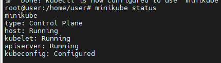
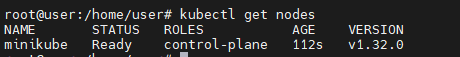

# How to Install and Configure Minikube on Ubuntu 24.04 with Docker Driver

## System Requirements
* At least 2 CPUs 
* 4GB RAM 
* 20GB Disk space
* Ubuntu 24.04 LTS 

## Update & Install Required Dependencies

```
sudo apt update && sudo apt upgrade -y
sudo apt install -y curl wget apt-transport-https conntrack
```

## Install Docker

Since Minikube will use Docker as the driver, install Docker with:
`sudo apt install -y docker.io`
## Install Kubectl
kubectl is needed to interact with your Kubernetes cluster:
```
curl -LO "https://dl.k8s.io/release/$(curl -Ls https://dl.k8s.io/release/stable.txt)/bin/linux/amd64/kubectl"
sudo install -o root -g root -m 0755 kubectl /usr/local/bin/kubectl
```
Verify installation:

`kubectl version --client`
## Install Minikube

```
curl -LO https://storage.googleapis.com/minikube/releases/latest/minikube-linux-amd64
sudo install minikube-linux-amd64 /usr/local/bin/minikube
```

Verify installation:
`minikube version`

## Start Minikube with Docker

Now, start Minikube using Docker as the driver
`minikube start --driver=docker`

Check the cluster status
`minikube status`



Verify that Kubernetes is running
`kubectl get nodes`



Your Minikube setup is now complete! 🚀

[Assets/minikube-status.png]: Assets/minikube-status.png